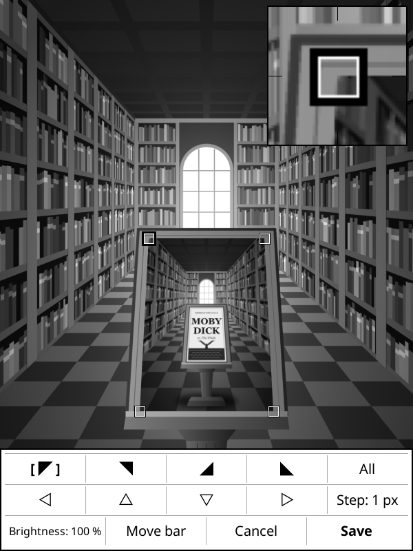

# coverscene.koplugin

A [KOReader](https://github.com/koreader/koreader) plugin for the sleep screen: instead of showing the cover of the current book on its own, it places the cover into a chosen area of a background picture, e.g. onto the lectern in a picture of a library.

The cover is warped onto four corners you set yourself, so it can follow a slanted surface in perspective and looks like part of the scene.

  

The three bundled pictures with an example cover: the library with its lectern, the gallery with its frame, and the mirror, where the roses are in front of the cover.

## What it does

- **Cover in a scene:** the sleep screen shows a background picture with the current book's cover placed into it, in perspective.
- **Several pictures:** any number of background pictures, each with its own place for the cover, shown in turn or at random. Single pictures can be switched off without losing their settings.
- **Three pictures included:** a library with a lectern, a gallery with a frame and a mirror with roses in front of it, ready to use.
- **Your own pictures:** add any picture from the device and mark the four corners of the cover in a full-screen editor with a magnifier.
- **Things in front of the cover:** a PNG with transparent parts goes over the cover, for a hand holding the book or a frame overlapping it.
- **Cover brightness:** the cover can be darkened per picture, so it fits a dim scene.
- **Sharing:** a picture is exported as a single file that carries its corners, and adding that file on another device sets everything by itself.

## Install

1. Download this repository (**Code → Download ZIP**) or clone it.
2. Make sure the folder is named exactly `coverscene.koplugin` (the ZIP unpacks as `coverscene.koplugin-main`, so rename it).
3. Copy the folder into KOReader's `plugins/` directory on your device:
   - Kindle: `koreader/plugins/`
   - Kobo: `.adds/koreader/plugins/`
   - Android: `koreader/plugins/`
4. Restart KOReader.

## Setup

1. Set **Settings → Screen → Sleep screen → Wallpaper** to **Show book cover on sleep screen**. The plugin only steps in when that mode actually shows a cover, so KOReader's "ignore book cover" options keep working.
2. In **Settings → Screen → Sleep screen → Book cover in background picture**, tick **Place book cover into background picture**.
3. Check the result with **Background pictures → Library (bundled) → Preview**.

Out of the box this goes through the three bundled pictures, `library.png`, `gallery.png` and `mirror.png` (all 1236×1648, 3:4 like a Kindle Paperwhite), with the corners already set to the lectern, the frame and the mirror's glass, so no further setup is needed.

## The menu

Everything is in **Settings → Screen → Sleep screen → Book cover in background picture**:

- **Place book cover into background picture** switches the plugin on and off.
- **Background pictures** is the list of pictures, with one submenu per picture, and the entries to add more.
- **Order of pictures** is in turn or random.
- **Reset to default** goes back to the three bundled pictures.

## Background pictures

**Background pictures** lists the pictures, at first **Library (bundled)**, **Gallery (bundled)** and **Mirror (bundled)**. With more than one picture in the list, each sleep screen shows another one.

Tapping a picture in the list gives you **Use this picture**, **Set cover corners**, **Preview**, **Export for sharing** and **Remove** for that picture. Every picture has its own corners.

Unticking **Use this picture** takes a picture out of the rotation but keeps it in the list with its corners, so you can switch it back on later; the list shows a check mark for the pictures in use. With all of them switched off, the sleep screen shows the plain cover.

Removing only takes the picture out of the list; a removed bundled picture can be put back with its entry **Add … (bundled)**, which shows up while it is not in the list.

To use a picture of your own:

1. Copy it anywhere onto the device.
2. Pick it with **Add background picture**. The corner editor opens right away, so you can tell the plugin where the cover goes (see below).

If you only want your own pictures, remove the bundled ones. The file of a removed picture stays where it is.

The background is scaled to fill the screen in portrait and cropped centered, so a picture with the screen's aspect ratio shows completely.

**Order of pictures** chooses between going through the list in turn and picking one at random (never the same twice in a row). A picture whose file is missing, e.g. on a card that is not inserted, is marked "(missing)" and skipped.

**Reset to default** goes back to the three bundled pictures alone, with their original corners. Your picture files are not deleted.

## Setting the corners

**Set cover corners** opens that background picture full screen with the current book's cover (or a checkerboard, if there is none) warped onto the four corners. The screen has to be in portrait.

The editor, here with the README's own example picture standing in as the cover: markers on the four corners, the magnifier for the selected one at the top, the button bar at the bottom.

- Tap a corner, or its button `◤ ◥ ◢ ◣`, to select it; it gets the thick marker.
- Tap anywhere else on the picture to put the selected corner there.
- `◁ △ ▽ ▷` move it by the step shown on the **Step** button; tap that button to switch between 1, 5 and 25 px.
- **All** makes taps and arrows move all four corners together, for when the shape is right but the position is not. Tap it again to go back to single corners.
- The magnifier shows the surroundings of the selected corner four times enlarged, with the corner in its middle, since the finger covers the spot when tapping.
- **Brightness** darkens the cover in steps from 100 % to 50 %, so that it fits a dim scene instead of glowing in it.
- **Move bar** flips the button bar between bottom and top, in case it covers the area you are working on.
- **Save** keeps the corners and the brightness, **Cancel** discards the changes.

The cover is stretched to fill the four corners exactly, so the area should have roughly a book's proportions. The corners are stored relative to the picture, not the screen, so they stay correct on a device with a different resolution.

## Making a picture of your own

- **Size:** best in the proportions of your screen, portrait, and at least as large in pixels. 1236×1648 fits a Kindle Paperwhite; other proportions get cropped at the sides or at top and bottom.
- **Format:** anything KOReader can show, e.g. PNG or JPEG. On an e-ink screen it ends up in shades of gray, so check how it looks without color.
- **Place for the cover:** a flat area in roughly a book's proportions, about 2:3. It may be slanted or seen from the side; the four corners take care of the perspective.
- **Brightness:** if the scene is dim, lower the cover's brightness in the editor until it no longer stands out.

### Pictures with something in front of the cover

A scene can have three layers: what is behind the cover, the cover, and what is in front of it. All of it comes from one picture file: a PNG with transparent parts is laid *over* the cover instead of under it, so everything that is not transparent ends up in front. The bundled mirror is made that way: its glass is transparent, so the cover shows there, cut to the arched shape of the glass, while the frame and the roses stay in front of it and their shadow falls onto the cover.

To have something in front of the book in a picture of your own, like a hand holding it, a frame overlapping its edges or a ribbon across it:

1. In an image editor, make the place where the cover should show transparent, and leave everything that is in front of the book as it is.
2. Save it as PNG, which keeps the transparency (JPEG does not).
3. Add the picture and set the corners a little outside the hole, so that the cover fills it completely.

Half-transparent parts work too, e.g. a shadow falling onto the cover. Wherever the picture is transparent and no cover lies behind it, it shows white.

A picture without transparency works as before: the cover is drawn on top of it.

A picture that can have transparent parts gets one more entry in its submenu, **Picture in front of the cover**, ticked to begin with. Untick it to have the cover drawn on top of that picture after all, e.g. when a picture turns out to be transparent in places by accident and hides the cover.

## Sharing a picture

**Export for sharing** saves a copy of the picture into the home folder, with the corners and the brightness in its file name, e.g.

`library.coverscene-3600-4320-6400-4320-6618-7464-3382-7464-100.png`

That one file is all there is to pass on. To use a picture someone shared:

1. Copy the file onto the device without renaming it.
2. Pick it with **Background pictures → Add background picture**.

The corners and the brightness are taken from the name, so there is nothing to set; the list shows the picture under its short name. The numbers are the x and y of the four corners (top left, top right, bottom right, bottom left) in ten-thousandths of the picture's width and height, followed by the brightness in percent; a `-1` after that says that a see-through picture goes behind the cover. The file must keep its name, at least the part from `.coverscene-` on; if a chat or download renames it, change it back or set the corners by hand.

If you change the corners, the brightness or **Picture in front of the cover** of a picture that has them in its name, the file is renamed to match, so the name never passes on outdated numbers. Pictures with ordinary names are never renamed.

## Structure

- `coverscene_compose.lua`: scales the background, warps the cover onto the four corners and lays see-through pictures over it.
- `coverscene_editor.lua`: the full-screen editor for corners and brightness.
- `coverscene_scenes.lua`: the list of background pictures with their settings, the rotation between them and the file names for sharing.
- `main.lua` / `_meta.lua`: plugin registration, menu entries and the hook into KOReader's sleep screen.
- `library.png`, `gallery.png`, `mirror.png`: the bundled background pictures.
- `example.png`, `example_gallery.png`, `example_mirror.png`, `example_editor.png`: the pictures shown in this README, not used by the plugin.

## License

[AGPL-3.0](LICENSE), the same license as KOReader.
